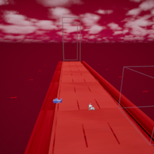

# Germ Endless Runner

<p>
  
  
  
  
</p>

**An endless runner set inside the human bloodstream.** You play as a **germ** sprinting down a blood capillary,
collecting **bacteria** and dodging **syringes** and **white blood cells** for as long as you survive.

<p align="center">
  
</p>

## Gameplay

- **Run endlessly** along a track inside a blood vessel. New track tiles are spawned ahead of you and old ones are
  cleaned up behind you, so the run never ends until you die.
- **Switch lanes, jump and duck** to line up with pickups and avoid obstacles.
- **Collect bacteria** along the way. They replace the usual "coins" and count toward your score.
- **Grab the magnet power-up** to pull nearby pickups toward you. A power-up slot on the HUD shows when it's active.
- **Avoid the barriers:** syringes and white blood cells. Touching one ends the run and takes you to the Game Over
  screen, which shows what you collected and your saved **high score**.

## Controls

| Action | Key |
| --- | --- |
| Move left | `A` |
| Move right | `D` |
| Jump | `Space` |
| Down / duck | `S` |

## How it works (Blueprints)

The whole game is built with Unreal Engine **Blueprints**, with no C++.

| Blueprint | What it does |
| --- | --- |
| `GM_Endless_Runner` | Game mode: spawns tiles, barriers and pickups, tracks the "can spawn" state and drives the run |
| `BP_Basetile` | One track segment: spawn points for environment pieces and buildings, and a trigger box that destroys the tile once it's behind the player |
| `BP_ThirdPersonCharacter` | The player: lane movement, jump, collecting pickups and power-ups |
| `BP_Player_Camera` | Follow camera that tracks the player's lane position |
| `Endless_Controller` | Helper actor with per-frame run logic |
| `Interactables/Coin` | Collectible with a pickup sound (the bacteria pickup) |
| `Interactables/Coin_Magnet` | Magnet power-up |
| `Obstacle/Barrier`, `Barrier2`, `Slide_Barrier` | Obstacles with death-collision boxes |
| `Savegame/Savegame_Endless` | Save-game object that stores the high score |
| `HUD/PlayerHUD`, `PowerUP_Slot`, `GameOver_Screen`, `MainMenu` | UI: collected counter, power-up slot, game-over summary, main menu |
| `Germ_Animation` | Animation Blueprint for the germ |
| `Material/MF_CurvedWorld`, `MPC_CurvedWorld` | Curved-world material function and parameter collection that bends the track into the distance |

## Project structure

```
Unreal_Final_Project/
├── Unreal_Final_Project.uproject      Unreal Engine 5.7 project
├── Config/                            Engine, game and input settings
├── Content/
│   ├── Input/                         Enhanced Input actions and mapping contexts
│   ├── ThirdPerson/Blueprints/        Game mode, player, camera, tiles, level, HUD, obstacles, pickups, save game
│   └── __ExternalActors__/            Level actors (One File Per Actor)
└── docs/screenshot.png
```

## Open the project

1. Install **Unreal Engine 5.7** from the Epic Games Launcher.
2. Clone this repository and double-click `Unreal_Final_Project.uproject`.
3. This repository holds the game's own **Blueprints, level, UI, materials and settings**. The 3D models, character,
   animations and sounds are **not** included (see [Credits](#credits-and-third-party-assets)). Import your own
   replacements or the originals into the folders they were in, otherwise the level will show missing meshes.
4. Press **Play** in the editor.

## Built with

- **Unreal Engine 5.7**, Blueprints, Enhanced Input, UMG (HUD and menus), Save Game system
- 3D models from online model libraries

## Status

A student final project. The character and pickup Blueprints still carry template names (for example the pickup is
called `Coin` internally, and the player is `BP_ThirdPersonCharacter`) from the Third Person starter project.

## Credits and third-party assets

The game uses 3D models, sounds and animations made by other people. They are not included in this repository, and
each one remains under its author's own license:

- Biology models used for the environment and obstacles (blood vessels, red blood cells, neutrophil, syringe, virus,
  and similar) were obtained from online 3D model libraries.
- **Magnet** by [aidanp](https://sketchfab.com/bionic_leaf), used under
  [CC BY 4.0](http://creativecommons.org/licenses/by/4.0/)
  ([source](https://sketchfab.com/3d-models/magnet-14f17cd9b48f4fe89aea6e69f80980d2)).
- Sound effects and music.
- Unreal Engine's Third Person template.

If you are the author of one of these and would like the credit changed, please open an issue.

---

Repository maintained by [@zubiajunaid954-bot](https://github.com/zubiajunaid954-bot).
